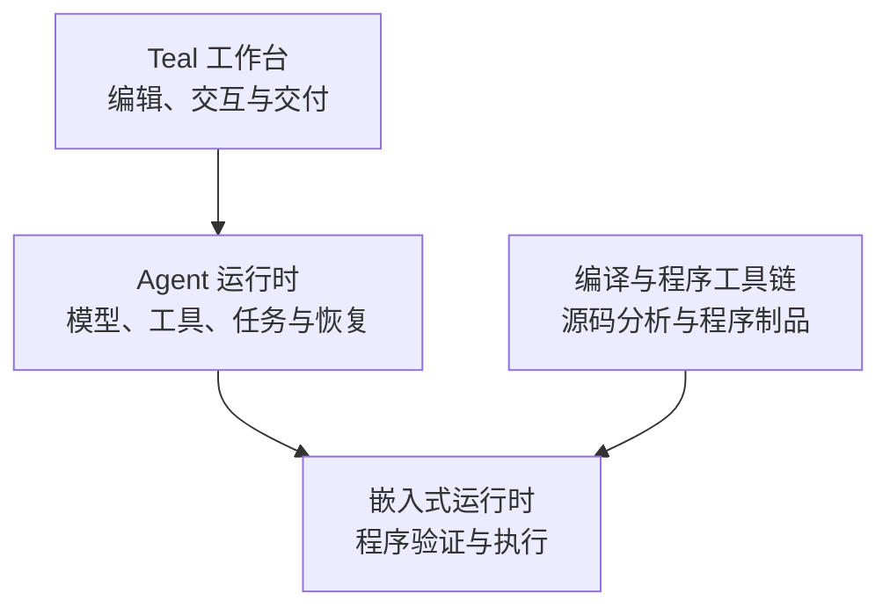
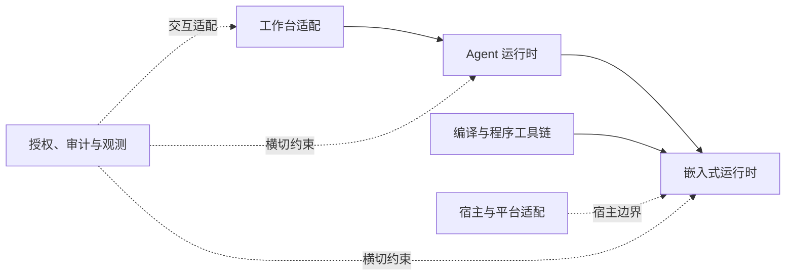

# Teal 架构

本文定义 Teal 的产品层次、职责边界、依赖方向和跨层不变量。它约束架构决策，不替代语言手册、工作台手册或 Cargo 包的实现说明。

Teal 将确定性计算与大语言模型推理组合在同一种静态类型语言中。产品由三个相互嵌套的层次组成：嵌入式运行时提供执行基础，Agent 运行时提供模型与任务编排，工作台提供面向人的编辑和交互。上层可以使用下层契约，下层不得依赖上层的产品交互或业务流程。

## 文档边界

| 文档 | 负责内容 |
| --- | --- |
| 本文 | 产品层次、能力平面、依赖方向、跨层不变量、非目标和架构决策原则。 |
| [根 README](../README.md) | 产品入口、用户可见能力、命令和跨包索引。 |
| [Teal 语言手册](TEAL-LANG-MANUAL.md) | 语言语义、标准功能、宿主条件、命令用法和用户可观察限制。 |
| [Teal 工作台手册](TEAL-BENCH-MANUAL.md) | 工作台启动、交互、脚本、配置、认证、权限和扩展用法。 |
| 各 Cargo 包的 `README.md` | 所属包的实现细节、数据流、持久协议、恢复顺序和版本约束。 |

本文中的“应”和“必须”表达架构约束；是否已经实现以及当前版本的具体行为，以对应包 README、测试和发布说明为准。

## 产品层次

### 嵌入式运行时

嵌入式运行时是最小的执行基础。它加载并执行已经验证的程序，维护语言状态，并通过抽象宿主边界请求外部效果。它不选择模型供应商、不实现 Agent 工具循环，也不拥有工作台交互。

编译器和程序工具链可以为嵌入式运行时生成程序制品，但不是嵌入式运行时的必需组成。源码编译、程序加载和执行应共享同一程序契约；选择包含工具链的宿主不会改变执行语义，也不会自动获得平台能力。

嵌入式运行时只依赖平台无关的语言、程序格式和宿主接口。文件、网络、进程、数据库、终端、模型、工作区和具体异步执行器属于上层宿主或能力适配，不应成为其隐含前提。

### Agent 运行时

Agent 运行时建立在嵌入式运行时的任务和外部请求边界上，负责把模型调用、工具调用、多个任务之间的协作、预算和恢复组织成可验证的程序流程。确定性逻辑仍由 Teal 程序执行；模型输出必须经过类型和程序规则验证后才能影响后续状态。

Agent 运行时通过宿主提供的能力使用文件、网络、进程或应用服务，不直接取得平台 I/O。它可以提供非持久执行和可恢复执行，但恢复承诺、事实记录和版本兼容性由所属包定义，不能由工作台界面状态推导。

Agent 应用的任务、计划、交付规则和允许的自我更新范围应由 Teal 程序表达。程序演化、记忆或知识更新和应用配置更新都必须留在既有授权边界内；程序、权限策略和运行时实现属于不同的变更域。

### Teal 工作台

工作台是面向人的集成开发与 Agent 交互层，负责编辑、配置、呈现、调试和交付。它通过 Agent 运行时和工作区服务使用编译、执行、授权和恢复能力，不复制语言语义、模型协议或权限判定。

工作台的业务流程应能在无界面宿主中运行和测试。TUI、GUI、CLI、LSP 和 DAP 是不同的交互适配器；它们可以改变呈现方式，不能改变所属层的语言、授权、执行或恢复语义。

## 能力平面

Native、FFI、Browser、Computer、Workspace、模型服务、存储、审计和观测是横跨产品层的能力平面或适配器，不构成第四个产品层。能力平面由宿主按需装配，并同时受到程序声明、资源范围和运行主体授权的约束。

- 运行时 Profile 只说明某种实现是否可用，不授予权限。
- 能力准备确定允许使用的能力范围；资源授权只能在该范围内细化，扩大范围必须重新准备。
- FFI、动态库和平台交互必须显式启用，并保持独立的类型、生命周期、审计和失败边界。
- 受控外部动作在授权、资源版本和审计条件无法确认时必须拒绝或故障关闭。
- 模型认证属于模型服务边界；它不能替代程序、工具或外部资源的授权。

能力平面可以被多个产品层复用，但不能把上层能力反向下沉为嵌入式运行时的隐含依赖。具体能力的注册、参数规范化、恢复和平台协议由所属包 README 说明。

## 依赖方向与职责归属

依赖方向表达职责归属，不是当前 Cargo 图的逐项复制：

- 程序格式是编译器与运行时之间的稳定契约；验证后的程序才能进入执行层。
- 执行层产生结构化的宿主或 Agent 请求，但不决定供应商、交互方式或平台副作用。
- Agent 层拥有模型循环、工具编排、任务协作、预算和恢复语义；模型服务层拥有认证、目录和协议传输。
- 工作台层拥有交互和呈现适配；业务流程通过可复用的运行时服务完成。
- 授权、审计和观测是横切约束。它们可以由不同宿主装配，但不能依赖 TUI、模型循环或命令行解析才能成立。
- 低层不得依赖高层的 UI、工作流、登录或业务规则；同一能力在不同前端应复用同一所属层契约。

包级职责、依赖例外和迁移状态应写在对应包的 README 或迁移记录中。本文不维护 crate 的逐项调用路径、目录迁移表或内部协议字段。

## 两个逻辑工作区

当前工作区用 [`teal-lang/workspace.toml`](../../teal-lang/workspace.toml) 和
[`teal-workbench/workspace.toml`](../../teal-workbench/workspace.toml) 固定两个仓库的成员
闭包。`teal-lang` 包含语言、Embedded Runtime、通用 Agent Runtime、模型协议和核心标准包；
`teal-workbench` 包含语言工具、编辑器、工作区服务、交互前端和应用扩展包。依赖方向固定
为 `teal-workbench → teal-lang`，拆仓后的工作台只能使用发布版本或固定 Git tag。

`teal-packages::PackageEnvironment` 同时绑定核心 catalog 与扩展 catalog 的摘要、语言
edition、package 格式和允许 domain。核心包不能被扩展包覆盖，扩展包不能声明编译器
Builtin；运行时锁与 import closure 必须携带这两个 catalog 身份。

## 跨层不变量

- **层次单向**：工作台可以使用 Agent，Agent 可以使用嵌入式运行时；反向依赖必须经过明确的适配边界。
- **程序契约稳定**：编译、验证、加载、快照和执行围绕同一程序格式与版本规则协作；损坏或不兼容的制品必须在进入执行层前拒绝。
- **边界类型化**：语言、宿主、模型和工作区之间使用明确的参数与结果契约，禁止未声明的句柄、循环值、越界布局和非法数值穿越边界。
- **能力与授权分离**：实现可用、程序声明、资源准备、用户批准和运行主体授权是不同事实，任何一项都不能替代其他项。
- **授权先于副作用**：外部动作必须在副作用前确认主体、策略、具体资源和版本；子任务、恢复和程序演化不得扩大现有授权。
- **运行版本固定**：一次运行固定其程序、能力和服务身份；代码、工具或能力的改变从新的版本或新的运行开始。
- **事实可恢复**：语言状态、模型与工具事实以及外部效果分别由所属层保存；未知外部效果只能通过当前授权下的证据结算，不能从本地快照猜测。
- **修改有统一边界**：编辑器、Agent、CLI 和 Teal 自动化对工作区的修改都经过同一事务、版本和批准约束；恢复运行不会凭空撤销已经发生的外部效果。
- **脚本优先**：Agent 和工作台的业务规则优先由 Teal 程序表达，Rust 提供通用运行机制和平台适配；交互前端不得成为业务状态的唯一来源。
- **前端语义一致**：CLI、SDK、LSP、DAP、TUI 和 GUI 共享所属层规则；平台差异必须显式失败或由适配层说明。
- **观测不改语义**：审计、日志、指标和性能分析不能改变授权、调度、恢复和结果；受控外部动作在必要审计无法持久化时必须故障关闭。

## 非目标与决策原则

- Teal 架构不把工作台 UI、模型供应商或某个本机平台作为语言和嵌入式执行的前提。
- `RuntimeProfile`、包导入、工具可见性或模型自述都不单独构成授权。
- 模型输出的结构合法性不等于业务正确性，也不自动构成批准或外部效果证据。
- 工作台会话、编辑器展示状态和宿主缓存不能充当 VM 或 Agent 的恢复凭据。
- 为了便利性把平台服务、交互逻辑或安全规则复制到多个前端，会破坏职责边界；新增能力应优先放入其所属层并由适配器复用。
- 本文不承诺尚未由实现、测试和发布说明共同确认的能力；架构目标与当前实现存在差异时，应在所属包或迁移记录中标明差异。
