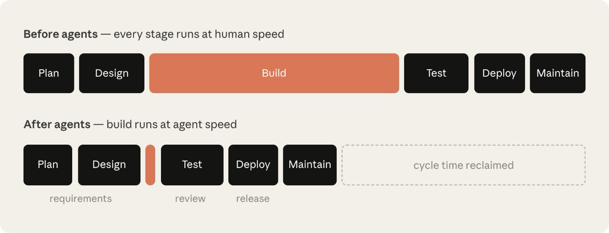
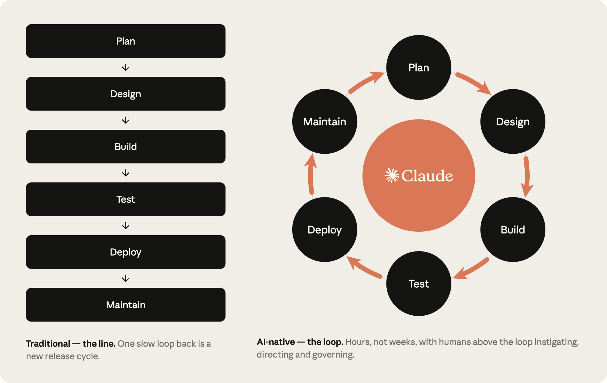

# AI 原生软件开发生命周期：逐阶段实践指南

> 本文译自 [The AI-Native SDLC Playbook](https://claude.com/blog/the-ai-native-sdlc-playbook)，作者 Louis Claxton，2026 年 8 月 21 日。产品名称、命令、文件名和链接保留原文。

## 目录

- [代码不再是瓶颈](#代码不再是瓶颈)
- [什么是 AI 原生 SDLC？](#什么是-ai-原生-sdlc)
- [实践方案](#实践方案)
- [规划](#规划)
- [设计](#设计)
- [构建](#构建)
- [测试](#测试)
- [部署](#部署)
- [维护](#维护)
- [结语](#结语)

## 代码不再是瓶颈

企业已经开始用 AI 以一年前难以想象的速度编写代码，但代码周围的流程并没有以同样的速度变化。许多工程团队仍在沿用相同的审批门禁、评审、交接和政策，这些环节拖慢了 Agent 编程带来的生产力提升。

软件开发生命周期（SDLC）是把软件从想法带到生产环境的过程。大多数组织都采用类似的六阶段流程：规划、设计、构建、测试、部署和维护。传统上，每个阶段由不同角色负责：产品经理编写需求，技术架构师将其转化为设计，工程师实现设计，受监管企业的 QA 团队进行验证，发布团队交付，运维团队监控线上系统。工作通过文档、工单和签字确认在阶段之间流转。

传统 SDLC 注重流程，是为了确保每一步都有责任归属和控制。然而，它诞生于“编写和实现代码是最耗时、最昂贵的环节”的时代。产品需求文档、估算仪式和产品安全评审，原本都是为了在开发可能持续数周、数月甚至数个季度时促成共识。传统控制也假设每一步都由人完成。

如今，创造最大价值的组织正在围绕 Agent 能力重建流程，同时让人类继续处在决策闭环中。代码不再是瓶颈后，会出现三个变化：

- 瓶颈转移到构建阶段左右两侧的环节，主要是规划、评审、测试和部署；这些环节仍以人的速度运行。
- 控制措施开始脱离现实。代码由人逐行编写时，逐行手工评审是合理的；当 Agent 生成大部分差异时，这种评审方式无法跟上。
- 治理成本上升，因为例外情况仍要通过每周或每月才召开一次的会议和委员会处理。



构建不再是约束，真正耗时的是它周围那些以人类速度运行的步骤。构建阶段可能缩短到数小时，而人工环节仍保持原来的长度，于是流程变成了中间快、两头慢的沙漏形。以安全瓶颈为例：安全团队按人类产出量配置，当 Agent 让代码产出成倍增长时，要么评审队列堆积，要么代码在评审不足的情况下发布。受监管组织两者都无法接受，因此安全和政策检查也必须跟上 Agent 的速度。

## 什么是 AI 原生 SDLC？

AI 原生 SDLC 是重新构想的软件开发流程：保留传统流程的控制目标，但采用全新的执行方式。流程不再是线性的，而是变成一个循环，AI 被嵌入每个节点。自动化交接可以触发后续步骤，减少传统阶段之间手工且笨重的交接。这种转型也被称为 Agentic SDLC、AI SDLC 或 Agentic Software Development；名称不同，描述的是同一件事。



### 六个阶段的变化

| 阶段 | 传统 SDLC | AI 原生 SDLC |
| --- | --- | --- |
| 规划 | 需求由委员会收集，经研讨会和层层签批后手工撰写 | Claude 直接综合源头中的痛点，并写入 `intent.md`；文件既便于人阅读，也可由机器执行 |
| 设计 | 分析师编写规格，设计师再解读需求 | 在一次与 Agent 的工作会话中压缩需求与设计；组织标准以 Skills 形式嵌入并在 git 中版本化 |
| 构建 | 测试和代码手写，文档事后补充 | 测试和代码由 AI 生成；组织知识维护在版本化、机器可读的 `CLAUDE.md` 和 Skills 中 |
| 测试 | QA 门禁设在阶段边界 | 持续 Evals 贯穿整个实现过程 |
| 部署 | 人类逐行审查代码，治理依赖评审周期 | 多层 Agent 评审，人类审查保留给受监管和关键代码；Hooks 作为审批门禁强制执行治理 |
| 维护 | 人类盯着生产环境寻找 bug | Agent 监控线上部署；突破控制带的异常会被诊断并写回循环，形成新的 `intent.md` |

右侧流程的核心是“已提交的制品”。每个阶段都把一个制品写入版本控制，下一阶段读取它：早期阶段主要是 `intent.md`、`spec.md` 和 `plan.md`；构建之后则是代码及其记录。提交链本身就是审计轨迹：谁提出了什么、Agent 产出了什么、谁批准了结果。人类仍对所有需要判断的决定负责，只是注意力转移到了真正需要审查的制品上。

## 实践方案

实践方案分为六个非线性阶段：规划、设计、构建、测试、部署和维护。每个方案说明变化内容、起步条件、实施步骤、治理考虑和衡量效果的方法。

阶段以提交制品结束，并由该提交触发下一阶段：接受 `intent.md` 触发需求与设计，批准 `spec.md` 触发计划模式，合并 PR 触发流水线，生产环境突破控制带则写入下一个 `intent.md`。起初可以手工触发每一步，最终目标是让每个被接受的制品自动触发下一道门禁。人的注意力集中在门禁上，评审 Agent 标出的内容，而不是每次都从头启动阶段。

## 规划

### 将想法记录为 `intent.md`

1. 发起人用自己的话向 Claude 描述问题：可以说明今天做不到什么、谁受到影响、理想结果是什么，或明确哪些内容不在范围内。不需要正式语言。
2. 与 Claude 头脑风暴，直到想法具体化。Claude 会询问分析师通常会问的问题：范围、用户、约束和成功标准。
3. 要求 Claude 使用组织模板将结果写成 `intent.md`。模板可以由技术团队成员编码为 Skill，并由负责人签字确认。
4. 发起人修正 Claude 的误解。
5. 将 `intent.md` 提交到共享位置。作者和时间戳随记录保存，产品负责人据此接手。

示例：

```markdown
# Intent: 理赔状态自助查询

作者：J. Ortiz（理赔运营）。状态：草稿。

## 问题
客户打电话到联络中心询问理赔进度，处理人员约三分之一的通话时间都花在仅查询状态上。

## 预期结果
客户可以在门户中看到理赔状态、下一步和预计日期。

## 受影响的用户和系统
理赔处理人员、门户团队、claims-core API。

## 约束
门户会话中不得新增个人身份信息，只使用现有认证机制。

## 未决问题
第三方损失理算师是否也需要访问？
```

证据就是已提交的 `intent.md`：它包含作者、时间戳和完整修订历史，并记录在 intent 仓库的 git 历史中。产品负责人批准或拒绝该意图；决定通过合并或关闭评审记录，并由此进入第二阶段。领先指标是从首次对话到提交 `intent.md` 的时间，目标是从数周缩短到数小时。滞后指标包括接受进入设计阶段的文件比例，以及同一变更的首个 `spec.md` 提交之后对 `intent.md` 的修改次数。

`intent.md` 可以来自人的想法、工单或生产告警。无论来源是事件还是 Agent，产品负责人都必须在提交前审查并修正 Agent 写出的文件。最简单的存放位置是产品仓库中的 `intent/` 目录；只有当意图横跨多个仓库时，才值得建立独立仓库。没有 git 经验的贡献者可以通过 GitHub 等版本控制连接器，让 Claude 代为提交 Markdown 文件。

## 设计

### 需求与设计

批准 `intent.md` 后，Claude 在组织的品牌、安全、合规和 UX Skills 约束下生成需求与设计规格。产品负责人审查规格，但不必亲自编写。前端工作尤其适合这种方式：产品负责人可以从 `intent.md` 在 Claude Design 中制作和迭代原型，再导出到 Claude Code 构建。

执行步骤如下：

1. 产品负责人开启带有组织 Skills 的会话，并附上 `intent.md`。
2. 提示词指向 `intent.md`，说明约束，并要求标出疑点。稳定后可编码为组织级 slash command；合并时运行非交互任务并提交 `spec.md` PR。
3. 产品负责人根据原始想法审查规格：它是否解决了提出的问题？未决问题是否已回答或被明确保留？
4. 先处理标出的疑点，并由对应政策负责人解决冲突，然后工程团队才看到规格。
5. 将 `spec.md` 与 `intent.md` 一起提交。
6. 产品负责人决定是否进入构建；高风险变更还应咨询技术负责人。接受规格后才启动第三阶段的计划模式。

提示词示例：

```text
阅读附带的 intent.md，为将其集成到现有代码库中生成需求与设计规格。
应用可用的 Skills，使计划符合品牌指南、安全政策和 UX 标准。
将完整规格写入 spec.md，确保工程团队可以直接使用。
清楚记录所有疑点，尤其是无法同时满足相互冲突的政策之处。
```

政策在规格编写时就被应用，而不是数周后才在评审中发现；规格、生成它的提示词和生效中的 Skill 版本都保存在版本控制中。领先指标是 `intent.md` 提交到 `spec.md` 提交的时间，滞后指标是构建开始后的需求返工次数。

## 构建

### 默认从 Claude Code 计划模式开始

工程师在计划模式中提供已批准的 `intent.md` 和 `spec.md`，让 Claude 读取代码库但暂不修改文件。Claude 产出实现计划，列出要修改的文件、工作顺序和证明变更正确的测试。工程师应追问可能破坏什么、最有风险的步骤是什么，以及还有哪些方案没有采用，直到一名从未看过对话的工程师也能仅凭计划完成工作。

批准后将计划提交为 `plan.md`，然后让 Claude 实现。若实现偏离计划，应在同一提交中同步更新 `plan.md`。

```markdown
# Plan: 理赔状态自助查询（来自 intent.md，2026-06-02）

## 变更文件
portal/src/claims/StatusPanel.tsx（新增）、claims-api/routes/status.py、
claims-api/tests/test_status.py

## 工作顺序
1. 在现有认证机制后增加状态端点。
2. 根据端点实现面板。
3. 接入门户导航。

## 风险
claims-core API 限制为每秒 50 个请求，面板必须缓存。

## 证明
test_status.py 覆盖四种理赔状态；截图与已批准的原型一致。
```

计划模式让设计评审发生在代码生成之前。常规变更由工程师批准；高风险变更交给技术负责人或架构师。领先指标是首轮实现即合并的变更比例和从批准计划到合并 PR 的时间；滞后指标是返工次数，以及最终差异是否仍符合 `plan.md`。

### 自动模式、旧系统与组织知识

在 `spec.md` 清晰、影响范围小、测试覆盖充分，且 `CLAUDE.md`、Skills、Hooks 和测试套件已经成熟时，Claude Code 自动模式可成为常规工作的默认方式。关注点从盯着 Agent 修改文件，转向更长自主会话后的制品评审；结合 worktree，自动模式还支持并行工作流。

迁移时应为每类制品指定一个事实来源。可以让仓库中的 Markdown 文件作为权威记录，让旧系统引用提交；也可以让 Jira、ServiceNow 或需求工具作为权威记录，Markdown 作为工作副本并通过 MCP 回写。无论采用哪种方式，所有制品都应记录关联 ID，旧记录应记录提交 SHA。

`CLAUDE.md` 应包含新成员第一天需要的构建、测试和 lint 命令、重要约定，以及 Claude 经常犯错的地方。运行 `/init` 生成起点后删减内容，将它提交到仓库根目录并像代码一样评审。实用规则是：Claude 犯同一个错误两次，就把修正写入 `CLAUDE.md`；文件应保持在一页以内。

### 用 Skills 保存组织知识

选择一条目前执行不一致的知识，例如安全标准、API 约定或品牌规则。根据政策负责人的事实来源，将它写成包含 `SKILL.md` 的 Skill，放在 `.claude/skills/<name>/` 随代码发布，或通过组织级 plugin 分发。在不同表述的任务中测试其是否都会触发，政策变化时由政策负责人批准修改。

```markdown
---
name: secure-api-review
description: 创建或修改对外端点、评审 API 代码或生成 OpenAPI 规格时使用。
---
# 安全 API 评审

1. 每个端点需要网关 JWT，除 /health 外不得有匿名路由。
2. 根据 OpenAPI schema 校验请求体并拒绝未知字段。
3. 状态变更端点必须发出包含 actor、action、entity、timestamp 的审计事件。
4. 标记为 pii 的字段不得出现在日志或错误消息中。

运行 scripts/check-endpoints.sh，并在总结中附上输出。
```

Skill 是建议性控制；必须始终成立的政策还需要 Hook 或 PR 评审在背后确定性执行。领先指标是政策批准到 Skill 合并的时间；滞后指标是 PR 中引用该政策的评审发现数。

### Hooks、并行会话与子 Agent

构建期 Hook 可以阻止编辑受保护路径、在文件编辑后运行格式化和 lint、并防止凭据进入差异。Hook 应快速且只检查发生变化的文件；完整测试套件放在提交或 PR 阶段。需要人批准的 Hook 属于部署阶段，因为构建期审批会让人重新成为所有并行会话的瓶颈。

团队 Hook 放在 `.claude/settings.json`，不可绕过的 Hook 放在平台或 IT 管理员维护的托管设置中。工程师可以把触及不同文件的任务拆开，让每个 Claude Code 会话在独立 git worktree 中运行；反复出现的工作可以封装为 `.claude/agents/` 中的子 Agent。两个或三个并行会话是合理起点，实际上限取决于工程师能否保持评审质量。

## 测试

### 给 Claude 一个反馈闭环

无论是测试、构建还是截图差异，都要给 Claude 一种自行验证工作的方式。把检查命令封装成失败时返回非零状态的目标，例如 `make test`；在 `CLAUDE.md` 中列出命令及健康输出；把成功标准写得可量化。

修复 bug 时先写失败测试：让 Claude 复现问题并确认测试因预期原因失败，再提交测试；之后要求 Claude 在不编辑测试的前提下修复代码。对于 UI，要让 Claude 能看到浏览器或截图结果，反复实现、截图、比较和调整。反馈闭环贯穿整个任务；验证子 Agent 则可以在全新上下文中执行最终检查。

```markdown
## 验证工作
- Build: make build（必须以 “Build succeeded” 结束）
- Test: make test（全部通过；不得跳过或删除失败测试）
- Lint: make lint（零警告）

报告任务完成前运行以上三项并粘贴输出。如果测试失败，修复代码，不要修改测试。
```

### CI 中的持续 Evals

Evals 是 AI 原生流程对应的阶段门禁 QA。平台工程师从近期工作中收集 20 到 50 个真实任务及其预期结果，把每个任务写成“提示词加检查”。套件在 CI 中按计划运行，并在 `CLAUDE.md`、Skills 或 Hooks 变化时运行。每个生产事故都应转化为 Eval 并长期保留。

```yaml
name: Agent evals
on:
  pull_request:
    paths: ['CLAUDE.md', '.claude/**']
  schedule:
    - cron: '0 2 * * *'
```

通过率阈值应作为合并检查，运行结果应长期记录。领先指标是 Eval 通过率以及生产事故转化为永久 Eval 所需的时间；滞后指标是 CI 捕获的回归与生产环境发现的回归之比。随着模型进步，失去区分度的案例需要被新案例替换。

## 部署

### 将 AI 纳入 PR 评审闭环

最快的起点是启用托管 Code Review 服务；需要控制流水线或使用自有云协议时，可以在 CI 中运行 `claude-code-action`。技术负责人将评审政策写入根目录的 `REVIEW.md`，分成 bug 和逻辑错误、安全与漏洞、对 `spec.md`、`plan.md` 及设计原则的合规性几轮，并定义 Important 与 Nit 的区别。

所有 PR 都获得一致的评审轮次，并按严重性排序。发现本身不能自动批准或阻止 PR；分支保护仍要求代码所有者批准。作者或评审者标记 `@claude` 后，Claude 可以处理评论并推送修复，PR 线程保留请求和变更。评审第二次指出同一错误时，把修正写入 `CLAUDE.md`。

```markdown
# 评审说明
## 评审轮次
- Bugs：逻辑错误、损坏的边界情况、隐蔽回归
- Security：注入风险、认证缺口、日志中的个人信息
- Compliance：变更符合 spec.md、plan.md 和设计原则
## Important 的含义
只有会破坏行为、泄露数据或违反政策的发现才标为 Important；样式和命名问题属于 Nit。
## 限制 Nit
每次评审最多报告五条 Nit，其余汇总为数量。
## 不要报告
src/gen/ 下的生成文件，以及 CI 已经强制检查的内容。
```

### Hooks 作为审批门禁

工程领导、变更管理和合规团队先列出必须保留的人类审批，例如变更管理签字、发布授权和受保护路径的编辑。平台工程师把每道门禁写成 Hook，在 Claude 行动前运行，可允许、询问或阻止。不可绕过的 Hook 放在托管设置中；阻止消息必须解释原因和审批方式。Hook 的条件每次都执行，决定带时间戳记录。

### 受监管企业与 CI/CD

平台团队可以通过 MDM 或管理控制台部署托管设置，拒绝读取 `.env*`、`./secrets/**`、`~/.ssh` 和 `~/.aws/credentials`，限制任意网络命令，只允许安全的 git、构建、测试和 lint 内循环，强制沙箱、网络域名白名单、托管 Hook、托管 MCP、批准的插件市场及最低 Claude Code 版本。所有限制都要根据仓库的数据分类调整。

在 CI/CD 中，先用 `claude -p` 只读分析失败构建、总结 flaky test 或起草变更日志，再把修复 lint、更新生成文档和处理评审评论等写入步骤放在现有门禁之后。Agent 写出的内容必须通过 PR 和分支保护，不能直接推送到 main。Agent 应在没有长期生产凭据的沙箱中运行，部署、状态和回滚通过 MCP 暴露，并按环境设置自治级别。回滚应是最成熟、最常演练的流水线路径。

```yaml
- name: 分析失败构建
  if: failure()
  run: >
    claude -p "读取 out/build.log，找出最可能的原因，判断失败看起来是
    flaky 还是实际故障，并为 PR 线程写三行摘要。" >> triage.md
```

基本原则是：Agent 可以行动到生产门禁为止，但不能越过它。分支保护阻断 Agent 直达 main；生产部署 Hook 等待指定发布经理授权；流水线日志区分 Agent 的操作和触发它的工程师。领先指标是无需通知人工即可分析的流水线失败比例；滞后指标使用 CI 和部署工具提供的 DORA 指标。

## 维护

### 维护与闭环

维护阶段把重点从人工启动转向自主运行。持续运行的监控 Agent 可以根据 bug 工单创建 `intent.md`，并使其流经需求、计划、构建、测试和评审。维护阶段以无头模式运行，阶段之间设置独立的置信门，由确定性检查或对抗性评审 Agent 决定结果是否继续，或升级给人。

触发器可以是控制带突破、工单、频道消息或定时任务。Claude 进行诊断，只通过门禁路径行动，并把发现写成 `intent.md`。人类负责分诊和评审，不再负责启动工作。

### 让闭环运行起来

1. 选择一个具有稳定滚动基线的指标，例如 CI 测试失败率、发布后的 5xx 比例或 PR 周期时间。
2. 编写检测脚本，使用滚动窗口的均值和标准差，并配合 Western Electric 等规则捕获漂移和尖峰。脚本应版本化并有单元测试，检测过程不使用模型。
3. 在 `bands.yaml` 中定义响应层级：1σ 只记录，2σ 调用 Claude 进行只读诊断，3σ 才允许 Claude 行动，而且只能创建 PR 或触发预批准的 runbook。
4. 通过定时工作流、监控 webhook 或 Cron Job 触发，在 CI runner 或沙箱容器中的 Agent SDK 服务中运行 Claude。
5. Agent 按第一阶段格式把诊断写成 `intent.md`，包括异常、证据、预期结果、受影响系统和未决问题。
6. 服务负责人或值班工程师对队列分诊：立即修复、排期或关闭。关闭决定用于调节控制带、降低噪声。
7. 修复上线后，为该事故增加 Eval，防止问题再次出现。

```yaml
metric: ci_test_failure_rate
baseline: rolling_30d
rules: western_electric
tiers:
  1sigma: { action: log }
  2sigma: { action: diagnose, tools: "Read,Grep,Bash(gh run view *)" }
  3sigma: { action: propose, routes: [pull_request, runbook:rollback-deploy] }
```

控制带边界来自版本控制配置，权限和托管设置拒绝生产访问。调用、发现和分诊决定都带时间戳记录；服务负责人批准发现，变更进入正常 PR 评审门，Agent 能触发的 runbook 必须预先批准。领先指标是从突破到进入分诊队列中的 `intent.md` 所需的时间；滞后指标是最终合并为修复的发现比例，以及同类事故是否下降。

### 反复进行代码库扫描

安全扫描是特定模型在特定时刻对代码库的判断；代码和模型都会变化。因此应按计划对每个连接的仓库扫描，不需要人参与启动，并将发现送入与其他代码变更相同的门禁。首次对关键仓库做完整扫描作为基线，之后按项目设定周期。分诊时保留置信度，并为关闭的发现记录原因。

小范围修复进入 PR 评审门；架构性问题或跨服务问题写成第一阶段格式的 `intent.md`。修复上线后，将漏洞类别加入持续 Eval。Claude Security 等模型驱动的扫描应补充现有静态分析和依赖扫描，而不是替代 CI 中的确定性检查。扫描历史记录发现、修复和有意识接受的风险，修复不能直接从扫描工具进入生产。

### 用 Claude Tag 值守

事故也可能来自 Slack 或 Teams，例如事故频道中的紧急修复消息。Claude Tag 让 Claude 以自己的身份加入频道，为每个新事故提供第一响应者；响应本身成为未来调查可读取的记录和记忆。频道成员可以引导响应、测试假设和实时调查，频道历史构成审计记录。通过 MCP，Claude 可以验证指标是否回到基线，在讨论串中确认结果，并把复盘写入版本化的经验文件。

被工单标记或在频道中提出的其他工作也以同样方式分诊：小而明确的修复通过评审门形成 PR，更大的工作写入 `intent.md` 并回到第一阶段。闭环因此形成：触发器在没有人启动的情况下调用 Claude，发现重新以 `intent.md` 进入流水线。

## 结语

模型和运行框架已经足够先进，使组织不仅能够改变产出代码的方式，也能够改变完整的软件开发生命周期。这种转型仍把人类判断放在中心，并考虑大型企业的治理和监管要求。

本文汇总了 Anthropic Applied AI 团队为客户实践的做法：每个阶段提交一个下一阶段可读取的制品，让组织知识成为文件，让护栏成为代码，让评审和审批集中在需要判断的地方。循环持续运行，而人类判断始终处于循环之上。

### 资源

- [Claude Code 组织设置与管理员决策图](https://code.claude.com/docs/en/admin-setup)
- [设置参考与优先级](https://code.claude.com/docs/en/settings)
- [Claude 管理控制台的服务器托管设置](https://code.claude.com/docs/en/server-managed-settings)
- [权限](https://code.claude.com/docs/en/permissions)
- [沙箱](https://code.claude.com/docs/en/sandboxing)
- [Hooks 指南](https://code.claude.com/docs/en/hooks-guide) 与 [Hooks 参考](https://code.claude.com/docs/en/hooks)
- [Skills](https://code.claude.com/docs/en/skills)
- [插件和私有市场](https://code.claude.com/docs/en/plugin-marketplaces)
- [托管 MCP](https://code.claude.com/docs/en/managed-mcp)
- [企业部署与第三方集成](https://code.claude.com/docs/en/third-party-integrations)
- [企业网络配置](https://code.claude.com/docs/en/network-config)
- [OpenTelemetry 监控](https://code.claude.com/docs/en/monitoring-usage)
- [分析面板](https://code.claude.com/docs/en/analytics)
- [合规 API](https://platform.claude.com/docs/en/manage-claude/compliance-api)
- [安全模型](https://code.claude.com/docs/en/security)
